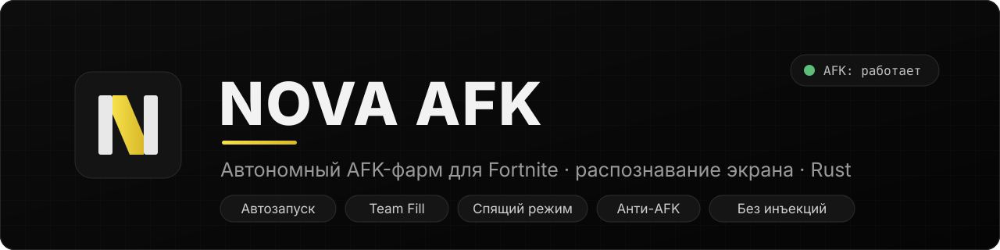
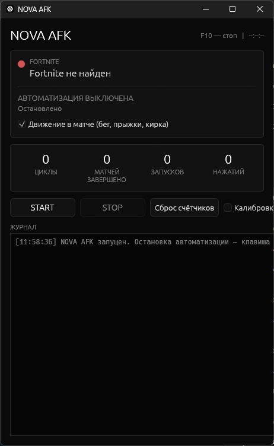
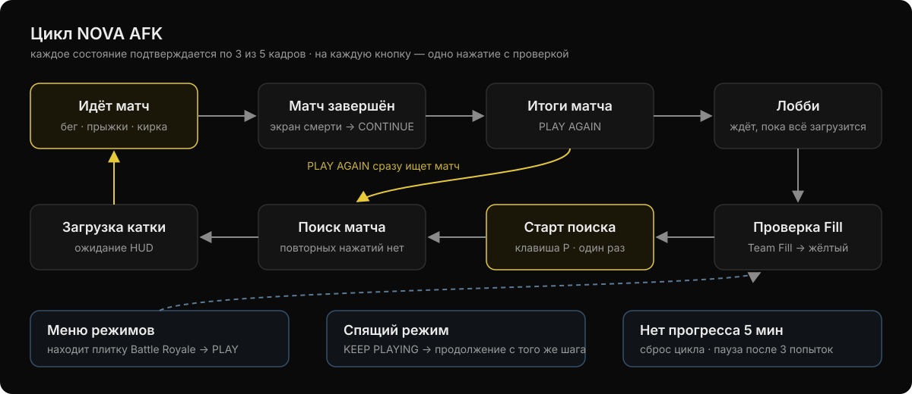
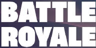
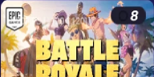

<p align="center">
  
</p>

<p align="center">
  <a href="https://github.com/rashside66-commits/nova-afk/releases/latest"></a>
  
  
  
</p>

<p align="center">
  <b>Автономный AFK-помощник для Fortnite под Windows, написанный на Rust.</b><br>
  Сам распознаёт, что происходит на экране, и после каждого матча запускает следующий —<br>
  без внедрения в игру, только по картинке и обычному вводу мыши и клавиатуры.
</p>

> 🇬🇧 *Screen-recognition AFK helper for Fortnite on Windows 10/11. Detects the match,
> recap, lobby, mode menu and sleep mode from screen pixels and re-queues automatically.
> Pure Rust, no injection, no memory reading, no game API.*

<table>
  <tr>
    <td width="40%" align="center"></td>
    <td width="60%">
      <h3>Запустил — и спать</h3>
      <ul>
        <li>одна кнопка <b>START</b>, остановка — <b>F10</b></li>
        <li>индикатор состояния Fortnite в реальном времени</li>
        <li>счётчики циклов, завершённых матчей, запусков и нажатий</li>
        <li>журнал каждого действия (в окне и в <code>nova_afk.log</code>)</li>
        <li>калибровка под новый сезон прямо из окна</li>
        <li>строгий матовый чёрный интерфейс</li>
      </ul>
    </td>
  </tr>
</table>

---

## Возможности

| | |
|---|---|
| 🎯 **Автозапуск матчей** | Видит лобби, нажимает PLAY (клавиша **P**) и проверяет, что поиск действительно начался |
| 🔁 **После смерти** | Экран итогов → **PLAY AGAIN**; если не сработало — **RETURN TO LOBBY**; экран смерти → **CONTINUE** |
| 👥 **Team Fill** | Перед каждым поиском открывает настройки режима и включает «Заполнение», если оно выключено |
| 🗺️ **Меню режимов** | Если игра выкинула в меню режимов — находит **Battle Royale** и выбирает его |
| 😴 **Спящий режим** | Распознаёт экран «FORTNITE IS IN SLEEP MODE» и нажимает **KEEP PLAYING** |
| 🏃 **Движение в матче** | Бег, спринт, прыжки, повороты камеры, удары киркой — персонаж не стоит на месте |
| 🛡️ **Надёжность** | Подтверждение состояния по нескольким кадрам, одно нажатие на кнопку, повторы, самовосстановление |
| 🌙 **На всю ночь** | Не даёт Windows уснуть, работает часами, остановка — **F10** |
| 📜 **Журнал** | Каждое действие пишется в окно и в `nova_afk.log` |

## Как это работает

<p align="center"></p>

```
 захват окна (GDI) ──► распознавание (HSV + эталоны) ──► подтверждение (3 из 5 кадров)
                                                                │
                 ввод (SendInput) ◄── машина состояний ◄────────┘
```

Встроенные эталоны, по которым программа узнаёт экраны (вырезаны из реальных скриншотов 1920×1080):

<p align="center">
  &nbsp;&nbsp;
  &nbsp;&nbsp;
  
</p>
<p align="center"><sub>обычная кнопка PLAY · заголовок BATTLE ROYALE · плитка Battle Royale в меню режимов</sub></p>

Определяемые состояния: идёт матч · матч завершён · экран результатов · выход из матча ·
загрузка лобби · лобби готово · поиск матча · загрузка новой катки · матч запущен ·
меню режимов · настройки режима · спящий режим.

- **Распознавание** — доли цветов в HSV по областям экрана (жёлтая PLAY, зелёная полоса здоровья,
  мини-карта, фиолетовая панель) и сравнение с эталонами (нормированная корреляция).
  Встроенные эталоны (`assets/`) вырезаны из реальных скриншотов 1920×1080; свои можно снять
  кнопкой «Калибровка» прямо в программе. Все области заданы в долях окна, поэтому работают
  при любом разрешении 16:9.
- **Защита от лишних нажатий** — перед каждым нажатием кадр проверяется заново; после нажатия
  программа ждёт, пока кнопка изменится, и не нажимает её повторно (второе нажатие отменило бы поиск).
- **Восстановление** — если долго нет прогресса, цикл начинается заново; пауза ставится только
  после трёх неудачных попыток подряд. Потеря окна, зависание игры или застывшая картинка —
  автоматическая пауза с продолжением после восстановления.

### Чего программа НЕ делает

Не внедряется в процесс Fortnite, не читает память, не использует DLL-инъекции, игровые API
и не обходит античит. Только снимок экрана и обычный синтетический ввод (`SendInput`).

## Установка и запуск

### Готовый exe

Скачайте `nova_afk.exe` со страницы
**[Releases](https://github.com/rashside66-commits/nova-afk/releases/latest)** — установка не нужна.

### Сборка из исходников

Нужны Windows 10/11 и [Rust](https://rustup.rs) (toolchain `stable-x86_64-pc-windows-msvc`).

```bash
git clone https://github.com/rashside66-commits/nova-afk.git
cd nova-afk
cargo build --release
```

Готовый файл: `target\release\nova_afk.exe`.

### Использование

1. Запустите Fortnite в режиме **«Окно» или «Окно без рамки»** (в эксклюзивном полноэкранном
   захват может быть чёрным).
2. Запустите `nova_afk.exe`, нажмите **START** — окно программы свернётся, чтобы не закрывать игру.
3. Fortnite должен оставаться активным окном — программа сама возвращает ему фокус перед нажатиями.
4. **F10** — остановить автоматизацию в любой момент.

> Не держите развёрнутое окно NOVA AFK поверх игры: на части систем оно попадает в захват
> экрана и может закрыть нужные кнопки. Удобнее — свернуть его или вынести на второй монитор.

## Настройка

При первом запуске рядом с exe создаётся `nova_afk.json` — все области экрана, пороги и тайминги.
Основное:

| Параметр | По умолчанию | Что делает |
|---|---|---|
| `anti_afk` | `true` | Движение персонажа в матче (также переключается в окне) |
| `enforce_fill` | `true` | Проверять Team Fill перед каждым поиском |
| `use_start_key` | `true` | Запускать поиск клавишей P (иначе — клик по PLAY) |
| `poll_ms` | `300` | Частота анализа экрана |
| `confirm_window` / `confirm_needed` | `5` / `3` | Сколько кадров нужно для подтверждения состояния |
| `stuck_timeout_s` | `300` | Через сколько секунд без прогресса начинать восстановление |
| `results_settle_s` | `4` | Пауза перед нажатием PLAY AGAIN (экран итогов выезжает) |
| `hide_from_capture` | `true` | Пытаться скрыть окно NOVA AFK от захвата экрана |

Если формат файла устарел, программа сама заменит его на новый.

**Калибровка.** Если после обновления Fortnite что-то перестало распознаваться, откройте нужный
экран в игре, включите «Калибровка» и нажмите «Захват» у соответствующего пункта — эталон
сохранится в `templates/` и будет иметь приоритет над встроенной логикой. Включите «Отладка»,
чтобы видеть оценки по каждому экрану.

## Структура проекта

```
src/
  main.rs        запуск: окно, поток движка
  capture.rs     поиск окна Fortnite, захват кадра (GDI)
  vision.rs      распознавание экранов: HSV-признаки, эталоны, NCC
  automation.rs  машина состояний, подтверждение, нажатия, восстановление
  mover.rs       движение персонажа в матче (анти-AFK)
  input.rs       SendInput: мышь, клавиши, F10, запрет сна Windows
  config.rs      настройки (nova_afk.json)
  logger.rs      журнал (окно + файл)
  ui.rs          интерфейс на egui (матовый чёрный)
assets/          встроенные эталоны (Battle Royale, обычная кнопка PLAY)
docs/            картинки для README
```

Тесты распознавания: `cargo test`. Проверка на реальных скриншотах — положите их в папку и
задайте `NOVA_SHOTS=<папка>` (имена файлов — в `vision.rs`, тест `real_screenshots`).

## ⚠️ Важно

Автоматизация игрового процесса и AFK-фарм могут нарушать
[правила Epic Games](https://www.epicgames.com/site/tos) и привести к ограничениям или блокировке
аккаунта. Проект создан в образовательных целях; используете его на свой страх и риск.
Fortnite — товарный знак Epic Games, Inc.; проект с Epic Games не связан.

## Лицензия

[MIT](LICENSE)
